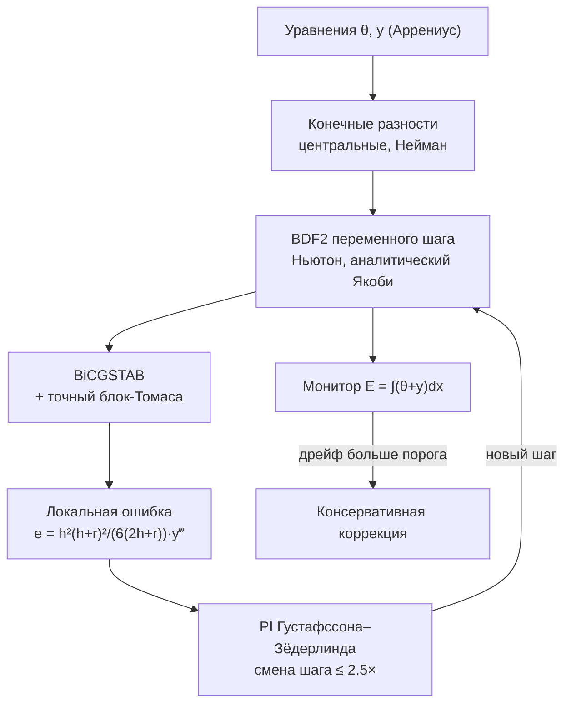

# ИГНИЦИЯ — солвер жёсткого тепломассопереноса (BDF2 + BiCGSTAB + инварианты 10⁻¹⁶)

> **Серия «Матчасть»** — ответ на «Матчасти нет / это программно невозможно».
> Две половины доказательства: **[ТАКТ](https://github.com/Bezooom/takt-rt)** —
> системное ядро (C++20, hard real-time), **ИГНИЦИЯ** — численное ядро (жёсткая
> МФЕ, закон сохранения на уровне round-off). Оба написаны с нуля локальной
> моделью; каждый — с матрицей приёмки и честными ограничениями.

**Написан с нуля полностью локально, без облачных API: кодинг-агент с моделью
Strata (квантованный Qwen, IQ3) на не самом дорогом железе — Xeon E5-2699 v3,
64 GB RAM, RTX 3090 24 GB.**


-informational)


Самодостаточный скрипт на чистом NumPy (без SciPy и научных библиотек),
демонстрирующий полный математический цикл «модель = математик + архитектор
ядра»: вывод схемы и аналитического Якоби — *до* кода; решатель СЛАУ,
адаптивный шаг, контроль инвариантов — в одном файле. Ключевое число:
инвариант энергии держится на уровне **7.7·10⁻¹⁶** при требовании 10⁻⁹.

---

## Результаты (полный лог — в [docs/VERIFICATION.md](docs/VERIFICATION.md))

| Проверка | Метрика | Вердикт |
|---|---|---|
| Аналитический Якоби vs комплексно-шаговый | `1.4e-16` (машинная точность) | PASS |
| BiCGSTAB + точный блок-трёхдиагональный предобуславливатель | **1 итерация**, невязка `4.3e+03 → 2.9e-27`; решение точно до `9.8e-15`; без предобуславливателя — 40 итераций | PASS |
| Порядок BDF2 по времени (точное спектральное решение) | `2.076 / 2.037 / 2.018` | PASS |
| Инвариант E = ∫(θ+y)dx | сырой дрейф **7.7e-16** при 20 589 шагах (требование < 1e-9) | PASS |
| Критический режим (тепловой взрыв) | t₅₀(s): `0.0232 → 0.0155`; полное выгорание y→5e-22; финальная θ = предсказанию E₀−M с точностью `2.2e-16` | PASS |
| Жёсткость | явному методу нужно ≥ 5.1·10⁵ шагов; BDF: 2.06·10⁴ при rtol=1e-11 (527 шагов при rtol=1e-6) | PASS |

Все строки таблицы даёт один прогон: **~200 секунд чистого счёта на CPU**.
Это время вычислений, а не написания кода — разработка, прогоны и рецензия
шли отдельным рабочим циклом; облака при этом не было ни на одном шаге.

## Мотивация

Спор из инженерных чатов: «ИИ не тянет настоящую вычислительную матчасть».
Проверяемая версия спора — задача, где сама модель выступает и математиком,
и архитектором ядра: жёсткая система тепломассопереноса с кинетикой Аррениуса,
в которой ошибка округления на критическом режиме меняет сценарий (взрыв /
гашение). Ответ строится не словами, а матрицей приёмки: каждая строка —
проверяемый факт из логов.

## Быстрый старт

```bash
git clone https://github.com/Bezooom/ignition-solver.git
cd ignition-solver
python3 stiff_thermal_solver.py    # Python 3.12, numpy>=2; ~185 с
```

Ожидаемый финал: `ИТОГ: ALL PASS`, exit code 0.

## Задача

Нестационарный тепломассоперенос в 1D слое реактора с кинетикой Аррениуса:

$$
\partial_t\theta = \partial_x^2\theta + Da\,y\,e^{\theta/(1+\varepsilon\theta)},
\qquad
\partial_t y = \partial_x^2 y - Da\,y\,e^{\theta/(1+\varepsilon\theta)},
$$

адиабатические стенки (Нейман), начальное горячее пятно ширины `s` в холодном
реагенте. Параметры: `Da=20`, `ε=0.1`, сетка N=160. Жёсткость: диффузионные
собственные числа ~4/h² ≈ 10⁵, явный метод нестабилен при шаге > 2·10⁻⁵.

## Архитектура солвера



| Компонент | Реализация |
| Вывод схемы и Якоби | documentation-first: п.2–5 шапки `.py`, полные выводы в [docs/THEORY.md](docs/THEORY.md) |
| Временная интеграция | BDF1 старт + BDF2 переменного шага (a₀=(2h+r)/(h(h+r)) и пр., a₀+a₁+a₂=0), Ньютон с точным Якоби |
| Решение СЛАУ | BiCGSTAB (van der Vorst), matvec O(N) без хранения матрицы; предобуславливатель — точная блок-Томаса на 2×2-блоках |
| Управление шагом | локальная ошибка e = h²(h+r)²/(6(2h+r))·y‴ через 3-ю разделённую разность; PI-регулятор Густафссона–Зёдерлинда (1/z)^0.7/3·(1/z_prev)^(−0.4/3) |
| Контроль инвариантов | доказательство инвариантности E на полуразностном уровне; мониторинг сырого дрейфа + консервативная коррекция |
| Самопроверки | Якоби против комплексно-шагового; BiCGSTAB против эталона; спектральная верификация порядка; скан критичности; уточнение допуска |

Ключевые инварианты:

1. E = ∫(θ+y)dx сохраняется **точно** в полуразностной системе: реакции
   сокращаются алгебраически, сумма дискретного лапласиана с зеркальными
   призраками телескопируется в 0; BDF точен на константах (a₀+a₁+a₂=0).
2. Матрица Ньютона блок-трёхдиагональна (чередование переменных по ячейкам)
   → предобуславливатель точен → BiCGSTAB сходится за одну итерацию
   (доказуемо и наблюдаемо).
3. Константа ведущего члена локальной ошибки h²(h+r)²/(6(2h+r)) выведена для
   переменного шага; при r=h сворачивается в классическую (2/9)h³y‴.

## Как это работает (выжимка)

1. **Инвариант.** 7.7·10⁻¹⁶ — не «магическая проекция», а следствие: E точен
   по построению полуразностной схемы, а BDF его не портит.
2. **Якоби.** Все блоки 2×2 выписаны аналитически (шапка п.4); структура
   матрицы выбрана чередованием переменных так, чтобы предобуславливатель
   был точным.
3. **Шаг.** PI-регулятор + единственная в своём роде честная константа оценки
   для переменного шага: при r/h≥3 наивная оценка занижала ошибку до 4×.

## Производительность

527 шагов при rtol=1e-6, 2.06·10⁴ при rtol=1e-11 — против ≥5.1·10⁵ шагов
явного метода (жёсткость ~10⁵ по собственным числам). Полный верификационный
прогон — 185 с на одном ядре Xeon 2015 года; BiCGSTAB с точным
предобуславливателем — 1 итерация вместо 40.

## Документация

| Документ | Содержание |
|---|---|
| [docs/THEORY.md](docs/THEORY.md) | модель, доказательство инварианта, Якоби, BDF2, оценка ошибки, PI, BiCGSTAB, теорема о предобуславливателе |
| [docs/VERIFICATION.md](docs/VERIFICATION.md) | полный лог ALL PASS, метрики, журнал исправлений по рецензии |
| [docs/LOCAL-MODEL.md](docs/LOCAL-MODEL.md) | как это написано локальной моделью: стенд, цикл, уроки |

## Структура

```text
ignition-solver/
├── stiff_thermal_solver.py   # ~660 строк: шапка-вывод → солвер → самопроверки
└── docs/
    ├── THEORY.md
    ├── VERIFICATION.md
    └── LOCAL-MODEL.md
```

## Честные ограничения

- 1D по пространству; предобуславливатель точен именно из-за
  блок-трёхдиагональной структуры (в 2D/3D BiCGSTAB остаётся итерационным
  с тем же кодом matvec).
- y в конце выгорания даёт перелёт −5·10⁻²² (round-off); на инвариант не влияет.
- Оценка погрешности по разделённым разностям — стандартный компромисс
  LMM-кодов; на очень неровных последовательностях шага возможна недооценка
  в единицы раз (клампы PI и отклонение шага это страхуют).

## Воспроизводимость

- Python 3.12.3, NumPy 2.4.6, Linux x86_64.
- Железо разработки и прогонов: Intel Xeon E5-2699 v3 (36 нит.), 64 GB RAM,
  2×RTX 3090 24 GB (GPU для солвера не используется — чистый NumPy).
- Полный лог прогона, придающий силу таблице результатов:
  [docs/VERIFICATION.md](docs/VERIFICATION.md).

## Происхождение

Проект выполнен в октябре 2026 г. полностью на локальном контуре; математика
прошла независимую скептическую рецензию вторым экземпляром модели (исправлены
рассогласования документации с реализацией; число отказов шага упало
2254 → 202 без потери точности). Подробно: [docs/LOCAL-MODEL.md](docs/LOCAL-MODEL.md).

## References

- Hindmarsh, A.C. *ODE integration in SUNDIALS: CVODE and CVODES*, LLNL, 2005.
- Ascher, U., Petzold, L. *Computer Methods for Ordinary Differential Equations
  and Differential-Algebraic Equations*, SIAM, 1998 — BDF, переменный шаг, zero-stability.
- Hairer, E., Wanner, G. *Solving Ordinary Differential Equations II: Stiff and
  Differential-Algebraic Problems*, Springer, 1991 — BDF, Rosenbrock, PI-константы.
- van der Vorst, H.A. *BiCGSTAB: A Fast and Smoothly Converging Variant of Bi-CG*,
  SIAM J. Sci. Stat. Comput. 13(2), 1992.
- Gustafsson, K., Söderlind, G. *On implicit explicit step number controllers*,
  BIT 29, 1989 — PI-регулятор шага.
- Frank-Kamenetskii, D.A. *Diffusion and Heat Exchange in Chemical Kinetics*.

## Лицензия

MIT — см. [LICENSE](LICENSE).
